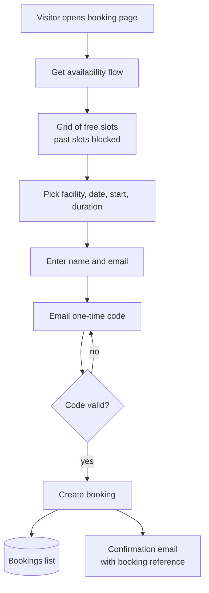
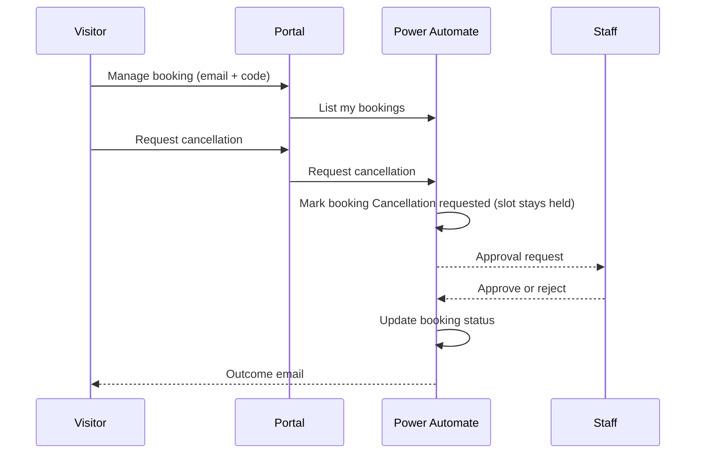

# Facility Booking Portal

A public booking site for a recreation centre. Visitors see which courts and rooms are free, book online after verifying their email with a one-time code, and manage their bookings, including requesting a cancellation that staff approve.

Built entirely on Microsoft 365: Power Pages for the front end, Power Automate for the logic and SharePoint for the data.

> Case study. The production code, flows and data belong to my employer and are not published. This repository documents the design, architecture and decisions. All names and values shown are generic.

## Booking flow

## Manage booking and cancellation

The slot stays held until staff approve, so nobody else can book it while a cancellation is pending.

## Things I learnt the hard way

- **Date comparisons.** SharePoint returns dates in US format text, so string comparisons put bookings in the wrong order. Comparing `ticks()` values fixed it.
- **Anonymous callers.** HTTP-triggered flows called from a public page need the trigger set to allow anyone. The default (any user in my tenant) returns 401. Re-importing a flow changes its trigger URL; editing in place keeps it.
- **Sync flattening styles.** A portal sync inlined base styles onto elements, and inline styles beat class rules, so drawers that open with a state class stopped opening. Making the state rules `!important` fixed it for good.
- **One deploy channel.** Uploading with the CLI and syncing from the studio can overwrite each other. I picked one source and stuck with it.
- **Know what is live.** A visible build tag and a console line per release made it obvious which version a browser was actually running.

## Stack

Power Pages, Power Automate (HTTP triggers, approvals), SharePoint Online lists, Outlook.
